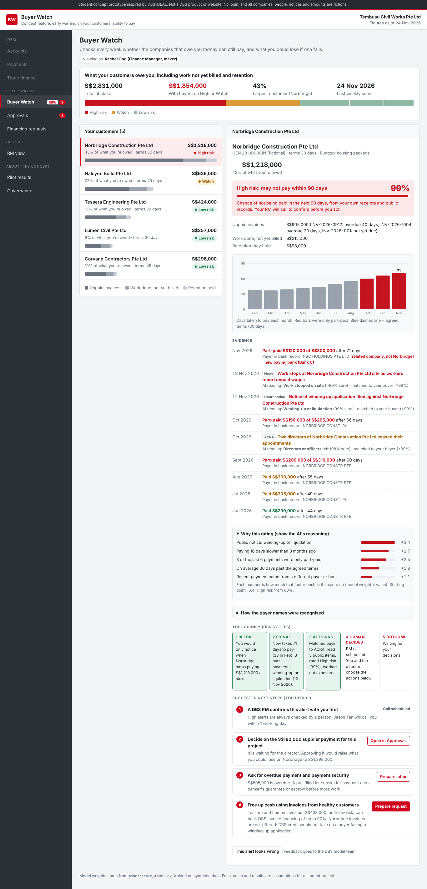
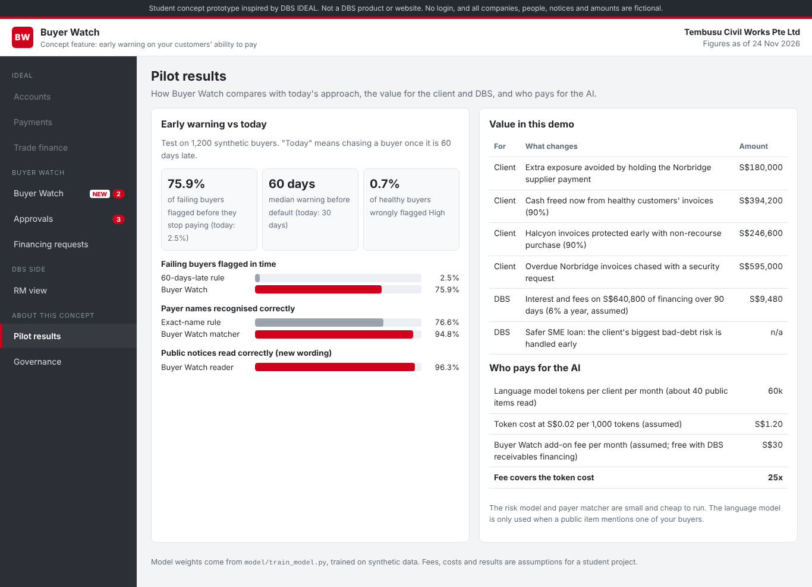

# Buyer Watch

**An AI feature for corporate banking that warns an SME when one of its own customers may not be able to pay, shows how much it could lose, and helps it protect itself before it is too late.**

> Student concept prototype for the Commercial Banking group project (Part II), styled after a corporate banking platform such as DBS IDEAL. Not a DBS product or website. There is no login, and all companies, people, UENs, notices and amounts are fictional. The models are trained on synthetic data.



## The idea in plain words

An SME such as a subcontractor often depends on a few big customers. When one of them gets into trouble, the SME only finds out when the payments stop. By then it is owed unpaid invoices, work it has done but not yet billed, and retention money.

Buyer Watch looks at two things every week:

1. **The SME's own incoming payments in IDEAL**: is this customer paying later, paying only part, or paying from a different company or bank?
2. **Public records and news**: winding-up notices, directors leaving, legal claims, work stopping on site.

It then rates each customer (Low, Watch or High), shows the evidence and its reasoning, and suggests next steps. People decide: the finance manager prepares, the director approves, the DBS RM confirms high alerts by phone, and DBS credit decides on any financing.

## What the prototype shows

| Screen | What to click |
|---|---|
| **Buyer Watch** | Total at stake, concentration bar, and each customer's rating. **Norbridge** is High risk: payment trend chart, evidence timeline, "Why this rating", how payer names were recognised, the DBS 5-step journey and suggested next steps. **Halcyon** is on Watch: protect its invoices now while risk is moderate. **Corvane** shows a winding-up notice for a different company being ignored (no false alarm). |
| **Approvals** | The director's view. A S$180,000 supplier payment for the Norbridge project comes with a Buyer Watch briefing. Approving it needs a reason, which goes into the audit trail. |
| **Financing requests** | Requests prepared from alerts: maker prepares, director approves, DBS credit decides. |
| **RM view** | The RM calls the client before a High alert is acted on, and sees clients who agreed to share alerts. |
| **Pilot results** | Early warning vs today, payer-name and notice accuracy, value for client and DBS, and who pays for the AI tokens. |
| **Governance** | Kill switch (falls back to plain incoming-funds alerts), allowed and blocked data (banking secrecy), safety nets for the review board, model card and live audit trail. |

## How the AI works

1. **Payer matcher** (small model): links names in bank records such as `NORBRIDGE CONST. P/L` to the right ACRA company, and spots payments coming from a related company instead.
2. **Notice reader** (text classifier; a language model in production): sorts public notices and news into types of warning sign.
3. **Risk model** (logistic regression): chance the customer fails to pay within 90 days, from five signals: paying slower, paying late vs terms, part-payments, change of payer or bank, and public warning signs. Every rating shows how much each signal contributed.

### Why AI and not just rules (synthetic test)

| | Today / simple rule | Buyer Watch |
|---|---|---|
| Failing customers flagged before they stop paying | 2.5% (chase at 60 days late) | **75.9%** |
| Median warning before default | 30 days | **60 days** |
| Payer names recognised | 76.6% (exact-name rule) | **94.8%** |
| Healthy customers wrongly flagged High | n/a | **0.7%** |
| Public notices read correctly (new wording) | n/a | **96.3%** |



More screens: [approvals](docs/screenshot-approvals.png) · [RM view](docs/screenshot-rm.png) · [governance](docs/screenshot-governance.png)

## Put it on GitHub (no coding needed)

**Easiest way (one file):** use the single `index.html` file that has everything built in.

1. On github.com click **+ → New repository**, name it `buyer-watch`, choose **Public**, then **Create repository**.
2. Click **uploading an existing file**, drag in the single `index.html`, then **Commit changes**.
3. Go to **Settings → Pages**, set Source to **Deploy from a branch**, Branch **main**, folder **/ (root)**, then **Save**.
4. Wait about a minute. Your site is at `https://<your-username>.github.io/buyer-watch/`.

**Full project (with the model code):** unzip the download, open the folder until you see `index.html`, select everything inside (`index.html`, `README.md`, `css`, `js`, `model`, `docs`) and drag it all into the upload box. Check the **Code** tab shows `index.html` at the top level, not inside another folder. Then do step 3.

To run it without GitHub, just double-click `index.html`.

### Retrain the models (optional)

```bash
pip install numpy scikit-learn
python model/train_model.py
```

## Project structure

```
index.html            Page layout (app bar, left menu, six views)
css/styles.css        Corporate-banking style, phone friendly
js/data.js            Fictional client, customers, payments, notices, pending approvals
js/engine.js          Payer matcher, notice reader, risk model, exposure
js/app.js             Screens, actions, maker-checker flow, RM view, governance
js/model-weights.js   Generated by the training script
model/train_model.py  Synthetic data, training and evaluation for all three models
model/weights.json    Same weights, readable
docs/                 Screenshots for this README
```

## 2-minute demo script

1. **Buyer Watch:** "Tembusu has S$2.8m at stake across five customers. Norbridge is 43% of it."
2. **Norbridge:** "It now takes 71 days to pay instead of 38, the last three payments were part-paid, the latest came from its parent company, and a winding-up notice was filed on 12 Nov." Open **Why this rating**, then **How the payer names were recognised**.
3. **Next steps:** "The RM calls first. Then prepare a letter asking for payment security, and free up cash using invoices from healthy customers." Click **Prepare request**, then **Send to director for approval**.
4. **Approvals:** "The director sees the briefing on the S$180,000 supplier payment and decides to hold it."
5. **Corvane:** "A winding-up notice for a different company with a similar name is ignored, so no false alarm."
6. **Governance:** flip the kill switch to show the fallback, then show the banking secrecy rules and the audit trail.

## Assumptions and limits

- Synthetic data and fictional companies only. A real pilot needs consented client data, a 3-month shadow run and independent model validation.
- The client uploads its invoices or connects its accounting system, and supplier payments are tagged by project.
- Add-on fee (S$30 a month), token cost (S$0.02 per 1,000 tokens) and financing rate (6% a year) are assumptions.
- Buyer Watch uses only the client's own transactions and public records, never other DBS customers' data (banking secrecy). It never acts on its own.

## Sources

- [Singapore companies forced to wind up hit 15-year high in 2024 (Singapore Law Watch)](https://singaporelawwatch.sg/Results/spore-registered-companies-forced-to-wind-up-hit-15-year-high-in-2024-minlaw-data)
- [HDB: Greatearth unable to continue with projects](https://www.hdb.gov.sg/hdb-pulse/news/2021/greatearth-corporation-pte-ltd-and-greatearth-construction-pte-ltd-unable-to-continue-with-projects)
- [DBS Accounts Receivable Purchase](https://www.dbs.com.sg/sme/financing/working-capital/accounts-receivable-purchasing)
- [DBS: Create and manage IDEAL alerts](https://www.dbs.com.sg/sme/contact-us.page/create-and-manage-ideal-alerts)
- [MinLaw Insolvency Office public notices](https://io.mlaw.gov.sg/corporate-insolvency/notices/)
